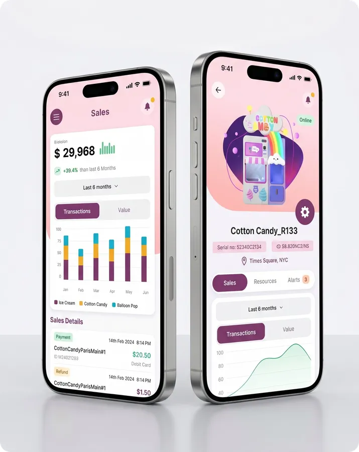
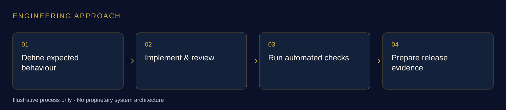

# Control Centre Engineering

### AI-powered management, remote diagnostics and camera-AI workflows

**Whitemore Ngwira · Engineering contributions at Sweet Robo**

[Sweet Robo — official website](https://sweetrobo.com/) · [Futureino — official website](https://futureino.ai/) · [Explore the public platform page](https://sweetrobo.com/)

  

*Sweet Robo’s published management-platform marketing visual. It provides product context; it is not a screenshot of an interface I claim to have designed. [View source image](https://sweetrobo.com/american/ai-app.webp).*

## My work

I contribute AI-powered software solutions to the Sweet Robo / Futureino management platform, including remote diagnostics and camera-AI workflows. My control-centre engineering also covers backend and portal workflows, API documentation, contract checks and automated validation.

**Skills:** AI-powered solutions · Remote diagnostics · Camera-AI workflows · Backend engineering · TypeScript · APIs · Kotlin · Continuous integration · Regression testing

## The product context

Sweet Robo publicly describes an AI-powered management platform for machine monitoring, analytics, technical support and remote control, alongside AI-driven diagnostics. Futureino’s public catalogue provides context for the connected-machine product categories. [Official source](https://sweetrobo.com/). [Futureino product catalogue](https://futureino.ai/).

## AI-powered solutions

- **AI-powered management platform:** I contribute AI solutions and supporting software engineering within the existing team-owned platform for connected machines.
- **Remote diagnostics and camera-AI workflows:** My AI solution work also includes these connected-machine support workflows, alongside debugging and validation.
- **AI Photo Booth app:** My related [application showcase](https://github.com/whitemorengwira/sweet-robo-photo-booth) covers AI-powered Android application engineering and diagnostics.

These public summaries explain my contribution within team-owned products; proprietary implementation and operational details remain private.

## My engineering contributions

- **Backend and portal workflows:** Contributed changes to operator and account-management workflows, supported by validation and review documentation.
- **API consistency:** Worked on API documentation and contract checks to make expected behaviour clearer across the software that uses it.
- **Continuous integration:** Added Kotlin test execution to CI and checked that missing, failed or skipped results could not be reported as a passing run.
- **Delivery evidence:** Prepared test evidence and review notes that distinguish implementation, technical review and deployment status.

## What I produced

Backend and portal changes, API quality artefacts and automated validation for technical review.

## Engineering approach

Joining application engineering with API discipline and repeatable quality checks across an existing team-owned system.

## AI-assisted engineering

Across my connected-machine work, I use **Claude Code** and **OpenAI Codex** to support code understanding, scoped changes, debugging, verification and technical documentation. I direct the work, review the output and distinguish software checks from physical-machine acceptance.

[See how I use Claude Code and Codex in my engineering workflow](https://github.com/whitemorengwira#software-engineering-with-claude-code--codex). This describes my development method; it does not expose internal agent instructions or proprietary implementation details.

## Explore the engineering series

- [Perfume Machine](https://github.com/whitemorengwira/sweet-robo-perfume-machine)
- [Vending Machine](https://github.com/whitemorengwira/sweet-robo-vending-machine)
- [AI Photo Booth App](https://github.com/whitemorengwira/sweet-robo-photo-booth) — AI-powered application engineering
- [Control Centre Engineering](https://github.com/whitemorengwira/sweet-robo-control-centre-engineering) — AI-powered management, remote diagnostics and camera-AI workflows — this showcase

## Sources and portfolio scope

Official product information and imagery: [Futureino](https://futureino.ai/) and [Sweet Robo](https://sweetrobo.com/). Product descriptions are attributed public context; the first-person contribution statements describe my own work within an existing team.

This documentation-only portfolio excludes proprietary source code, private infrastructure and non-public operational information. It does not imply sole product authorship, employer endorsement or completion of every hardware and release milestone. See [image credits and viewing notice](COPYRIGHT.md).

[Contact me](mailto:hello@nwhite.systems) · [N.White Systems](https://nwhite.systems/) · [GitHub profile](https://github.com/whitemorengwira)
