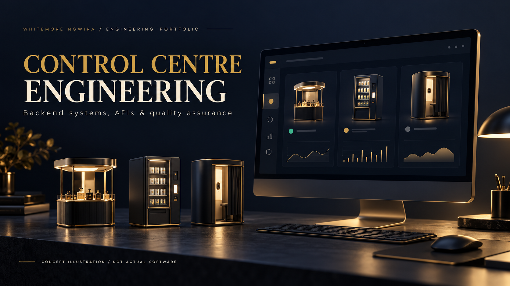

# Control Centre Engineering

### Backend systems, APIs & quality assurance

**Whitemore Ngwira · Sweet Robo · Selected engineering contributions**

*AI-generated concept illustration. The equipment and interface shown are fictional; they are not photographs or screenshots of Sweet Robo products.*

## At a glance

During my work at Sweet Robo, I contributed to the control-centre software that supports connected machines: backend and portal changes, API consistency, automated testing and engineering handovers.

**Focus:** Backend, API and delivery-quality engineering  
**Skills demonstrated:** Backend engineering · APIs · TypeScript · Kotlin · CI · Regression testing

## The engineering challenge

A control centre connects machine behaviour with operator workflows. Changes need clear API expectations, useful regression coverage and evidence that reviewers can assess before release.

## My contribution

### Backend and portal workflows

I contributed application changes for operator and account-management workflows, with supporting validation and review documentation.

### API consistency

I worked on API documentation and contract checks to make expected behaviour clearer across the software that uses it.

### Automated quality checks

I added Kotlin test execution to continuous integration and verified that missing, failed or skipped test results could not be mistaken for a passing run.

### Engineering handovers

I assembled test evidence and review notes while keeping implementation, review, merge and deployment status distinct.

## How I approached the work

*Illustrative delivery process; not a deployment topology, schema or internal service map.*

1. Define expected behaviour.
2. Implement & review.
3. Run automated checks.
4. Prepare release evidence.

## What the work produced

The work produced backend and portal changes, API quality artefacts and automated validation for technical review.

This describes contributions within an existing team-owned system. It does not claim sole authorship, production deployment, fleet-wide acceptance or measured commercial impact.

## Public review boundary

This is a documentation-only portfolio showcase. Private source code, internal platform names, infrastructure, endpoints, schemas, credentials, customer information, operational records and internal screenshots are excluded. Supporting work records remain private.

The narrative explains my contribution within a team-owned product. The concept artwork is not evidence of implementation or an employer-approved product design.

## Explore the series

- [Perfume Machine](https://github.com/whitemorengwira/sweet-robo-perfume-machine)
- [Vending Machine](https://github.com/whitemorengwira/sweet-robo-vending-machine)
- [Photo Booth](https://github.com/whitemorengwira/sweet-robo-photo-booth)

## Contact

[GitHub profile](https://github.com/whitemorengwira) · [N.White Systems](https://nwhite.systems/) · [Email Whitemore](mailto:hello@nwhite.systems)

I can discuss my engineering approach and responsibilities within the applicable confidentiality boundaries.

See [Portfolio viewing notice](COPYRIGHT.md).

